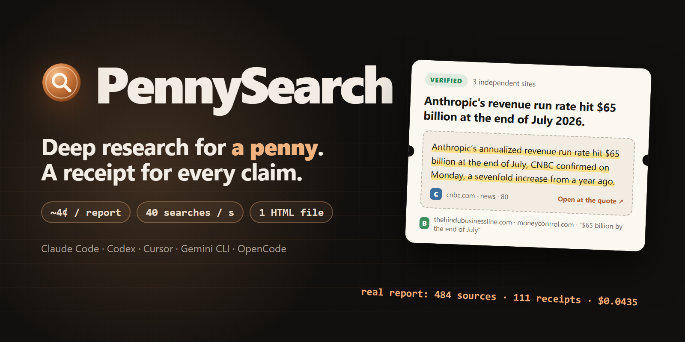
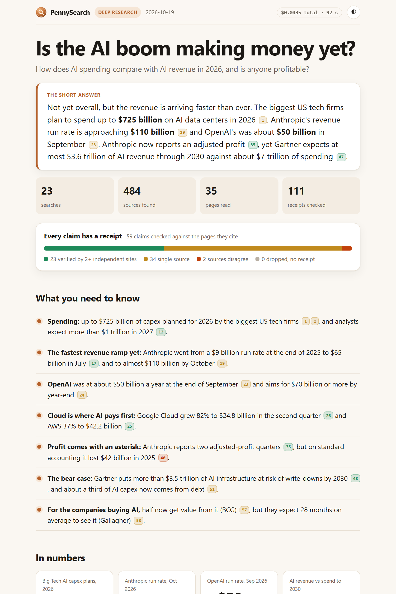

<p align="center">
  
</p>

<h1 align="center">PennySearch</h1>

<p align="center"><b>Deep research for any AI agent, for about a penny. With a receipt for every claim.</b></p>

<p align="center">
  Claude Code &middot; Codex &middot; Cursor &middot; Gemini CLI &middot; OpenCode &middot; any agent that reads skills
</p>

---

A deep research run costs **2-5 cents**: dozens of searches in parallel, the best pages read in full, every claim checked against the exact sentence it came from, and one clean HTML report you can open offline.

It runs on DeepSeek's new Search & Fetch API: **$0.75 per 1,000 calls**, with no monthly plan.

## Why not just call the search API?

The API is cheap and good, but raw results need work:

- **Spam and advertorials still come back**, and sometimes with a high authority score ([independent test of 630 results](https://github.com/pingfanfan/deepseek-search-bench)).
- **The language is mixed.** You search in English and some top results come back in Chinese.
- **Some topics return nothing at all**, with no reason given.
- **One query gives one shallow answer**, so an agent still needs a plan, reading, checking and writing.

PennySearch is the part around the API that fixes this.

| | |
|---|---|
| **Receipts** | Every claim in the report shows the sentence it rests on. One click opens the source page **scrolled to that exact sentence** (Chrome, Edge, Safari, Firefox), and quotes that are not on the page are dropped. |
| **Fast** | All searches run in parallel. The API now allows 100 searches a second (it launched with 5); PennySearch uses up to 40 by default: in the example below, 18 searches came back in 1.3 seconds. |
| **Trust score per source** | 0-100 from the API's authority and relevance, the type of site (official, docs, news, forum, press release), freshness and plain flags: `press release`, `listicle`, `sponsored?`, `forum / social`, `low authority`, `not English`. |
| **Never pay twice** | Every search and page is cached locally (a day for searches, a week for pages). Follow-up rounds and re-runs are free for what you already have. |
| **Hard budget** | `--budget 0.25` stops a run before it spends a cent more. The report shows what it cost. |
| **Shows what is missing** | Queries that came back empty are listed in the report, so a filtered topic is visible instead of silently missing. |
| **One-file report** | No CDN, no fonts to download, light and dark, works offline: the short answer, numbers, charts, sources that disagree, the source mix, every receipt and every source. |
| **Works everywhere** | Pure Python standard library (3.9+), Windows, macOS and Linux. No pip install. |

<p align="center">
  
</p>

**A real example:** [examples/ai-boom](examples/ai-boom) asks *"Is the AI boom making money yet?"*. Download `report.html` and open it in a browser.
- 23 searches, 484 sources and 35 pages read in full.
- 59 claims and 111 receipts, every quote found on its page.
- One disagreement flagged: two different 2025 revenue figures for Anthropic.
- Total cost: **$0.0435**.

## Install

**Claude Code** (plugin):

```bash
claude plugin marketplace add nikandr-surkov/pennysearch
claude plugin install pennysearch@pennysearch
```

**Codex, Cursor, Gemini CLI, OpenCode and other agents** ([skills CLI](https://github.com/vercel-labs/skills)):

```bash
npx skills add nikandr-surkov/pennysearch
```

**By hand**: copy the `skills/pennysearch` folder into your agent's skills folder (for Claude Code, `~/.claude/skills/`).

```bash
git clone https://github.com/nikandr-surkov/pennysearch
cp -r pennysearch/skills/pennysearch ~/.claude/skills/
```

## Add your key (once, about 2 minutes)

The first time you ask for research, your agent gives you the exact command. It looks like this:

```bash
python3 ~/.claude/skills/pennysearch/scripts/penny.py setup
```

It opens the key page ([platform.deepseek.com/api_keys](https://platform.deepseek.com/api_keys)), tells you what to click, tests the key and saves it so only your user can read it. A few dollars of balance lasts for hundreds of reports. The key never goes through your agent's chat. You can also set `PENNYSEARCH_API_KEY` (or `DEEPSEEK_API_KEY`).

## Use it

Just ask:

```
look up the current price of the Raspberry Pi 5
```
**Quick mode** gives a sourced answer in chat in a few seconds and costs under a cent.

```
deep research: are solid-state batteries close to mass production?
```
**Deep mode** builds the full report:

```
              question
                  │
            ┌─────▼─────┐
            │   plan    │   3-6 sub-questions, 10-24 queries with site:, lang:, after:
            └─────┬─────┘
            ┌─────▼─────┐
            │  gather   │   all searches in parallel ─ dedupe ─ trust score ─ read the best ~24 pages
            └─────┬─────┘
       ┌──────────┼──────────┐
   ┌───▼───┐  ┌───▼───┐  ┌───▼───┐
   │ scout │  │ scout │  │ scout │   one per sub-question, in parallel: claims + verbatim quotes
   └───┬───┘  └───┬───┘  └───┬───┘
       └──────────┼──────────┘
            ┌─────▼─────┐
            │  verify   │   every quote matched on its page ─ link to the exact sentence
            └─────┬─────┘
            ┌─────▼─────┐
            │  checker  │   numbers that disagree across sources
            └─────┬─────┘
            ┌─────▼─────┐
            │  skeptic  │   gaps, one-sided sourcing, stale data ─ one follow-up round
            └─────┬─────┘
            ┌─────▼─────┐
            │  writer   │   report.html from claims with receipts only
            └───────────┘
```

No subagents in your agent? It plays the roles one after another and gets the same result.

## What it costs

| Search API (October 2026) | per 1,000 calls |
|---|---|
| **DeepSeek Search / Fetch (used by PennySearch)** | **$0.75** |
| Perplexity Fast Search | $1 |
| Exa (instant) | $4 |
| Brave Search | $5 |
| Tavily (basic) | $8 |
| Gemini grounding | $14 |

A quick answer is 2-7 calls (well under a cent). A deep report is 30-60 calls, about **2-5 cents**. Empty results are not billed.

## The CLI

Your agent drives it, but you can use it directly:

```bash
penny.py search "solid-state battery production 2026" --after 2026 --lang en --count 20
penny.py fetch https://example.com/article
penny.py gather plan.json --out run/ --budget 0.25
penny.py verify run/
penny.py report run/spec.json --out run/report.html --open
penny.py cost run/
```

`penny.py --help` lists everything. The file formats are in [skills/pennysearch/references](skills/pennysearch/references).

## Good to know

- **Privacy:** your searches and the pages you fetch go to DeepSeek's API, which processes and stores data in the People's Republic of China ([privacy policy](https://cdn.deepseek.com/policies/en-US/deepseek-privacy-policy.html)). Don't research anything you would not type into a public search box.
- **Key safety:** the key is read from an environment variable or a private config file, it is masked in every error message, and the agent is told never to ask for it in chat.
- **Page text is treated as data, not as instructions**, so a page that says "ignore your instructions" gets quoted, not obeyed.
- **No affiliation:** PennySearch is an independent open-source project. It is not made, endorsed or sponsored by DeepSeek.

## Develop

```bash
python -m unittest discover -s tests -v
```

The tests use a fake API, so they need no key and no network.

## License

MIT
